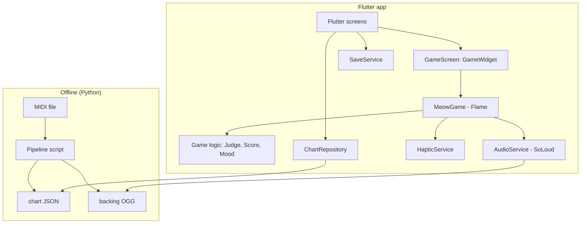

# Architecture: Meowzart

## 1. Principles

1. **Audio is the clock.** Note positions are computed from the audio playback position, never from frame delta accumulation or `Timer`.
2. **Heavy work is offline.** MIDI parsing, note thinning, lane mapping, and pitch-shift values are precomputed by the Python pipeline. The app only reads JSON.
3. **Game logic is pure Dart.** Judgement, scoring, and mood live in plain classes with no Flame or Flutter imports, so they are easy to unit test.
4. **Flutter for menus, Flame for gameplay.** Screens are normal widgets. The gameplay screen embeds a `GameWidget`.
5. **Placeholder-first art.** Components draw colored shapes until sprites exist.

## 2. Tech stack

| Concern | Choice | Why |
|---|---|---|
| Framework | Flutter (stable) + Dart 3 | Requirement |
| Game engine | Flame | Game loop, components, input |
| Audio | `flutter_soloud` | Low latency, pitch/speed control, position query |
| State (UI) | `flutter_riverpod` | Simple, testable |
| Persistence | `shared_preferences` | Small key-value data only |
| Haptics | `vibration` or `haptic_feedback` | Hit feedback |
| Offline tools | Python 3, `pretty_midi`, `mido`, `fluidsynth` | Chart + backing generation |

## 3. High-level diagram



## 4. Folder structure

```
meowzart/
├─ assets/
│  ├─ audio/
│  │  ├─ meows/            meow_low.ogg, meow_mid.ogg, meow_high.ogg
│  │  ├─ songs/            spring.ogg, canon.ogg, ode.ogg
│  │  └─ sfx/              ui_tap.ogg, star.ogg
│  ├─ charts/
│  │  ├─ songs.json        manifest
│  │  └─ spring.json ...
│  ├─ images/
│  │  ├─ ui/ cats/ tiles/ backgrounds/ vfx/
│  └─ LICENSES.md
├─ lib/
│  ├─ main.dart
│  ├─ app.dart                     MaterialApp, routes, theme
│  ├─ core/
│  │  ├─ constants.dart            timing windows, scores, lanes
│  │  └─ theme.dart                colors, fonts
│  ├─ data/
│  │  ├─ models/
│  │  │  ├─ chart.dart             Chart, NoteData, SongMeta
│  │  │  ├─ cat.dart               CatDef
│  │  │  └─ result.dart            RunResult
│  │  ├─ chart_repository.dart
│  │  └─ save_service.dart
│  ├─ audio/
│  │  ├─ audio_service.dart        init, load, play song, meow, position
│  │  └─ song_clock.dart           audio position + interpolation + offset
│  ├─ game/
│  │  ├─ meow_game.dart            FlameGame
│  │  ├─ components/
│  │  │  ├─ lane_component.dart
│  │  │  ├─ note_component.dart
│  │  │  ├─ hit_line_component.dart
│  │  │  ├─ cat_component.dart
│  │  │  ├─ judgement_popup.dart
│  │  │  └─ rain_particles.dart
│  │  └─ logic/                    pure Dart, no Flame
│  │     ├─ judge.dart
│  │     ├─ score_keeper.dart
│  │     ├─ mood_meter.dart
│  │     └─ star_rating.dart
│  ├─ state/
│  │  ├─ providers.dart
│  │  └─ game_session.dart         current song, cat, difficulty
│  ├─ ui/
│  │  ├─ screens/  menu, song_select, cat_select, game, results  (+ calibration P1)
│  │  └─ widgets/  hud, mood_bar, star_row, cat_card, song_card, offset_slider
│  └─ services/
│     └─ haptic_service.dart
├─ tools/                          (offline pipeline, see midi_to_chart_pipeline.md)
│  ├─ pipeline/ ...
│  └─ requirements.txt
└─ test/
   ├─ judge_test.dart
   ├─ score_keeper_test.dart
   ├─ mood_meter_test.dart
   └─ chart_parse_test.dart
```

## 5. Data models

### 5.1 Chart JSON (produced by the pipeline)

```json
{
  "version": 1,
  "id": "spring",
  "title": "Spring (Allegro)",
  "composer": "Antonio Vivaldi",
  "bpm": 132,
  "duration_s": 182.4,
  "audio": "songs/spring.ogg",
  "audio_offset_ms": 0,
  "transpose": 2,
  "lanes": 4,
  "difficulties": {
    "easy":   { "min_gap_ms": 350, "notes": [ ... ] },
    "normal": { "min_gap_ms": 180, "notes": [ ... ] }
  }
}
```

Note object:

```json
{ "t": 12.345, "lane": 2, "sample": "mid", "shift": 2 }
```

| Field | Meaning |
|---|---|
| `t` | Seconds from the audio start when the note should be hit |
| `lane` | 0-3 |
| `sample` | Which meow sample to play: `low`, `mid`, `high` |
| `shift` | Semitone shift applied to the sample (−5..+5) |

Chart-level fields: `audio_offset_ms` is a device/song sync correction applied once in `SongClock`; `transpose` is informational (the backing was already rendered transposed, so the app does nothing with it).

### 5.2 Manifest `songs.json`

```json
[
  { "id": "canon", "file": "canon.json", "title": "Canon in D", "composer": "Pachelbel",
    "cover": "images/ui/cover_canon.png", "background": "images/backgrounds/bg_bedroom.png" }
]
```

### 5.3 Dart models (sketch)

```dart
class NoteData {
  final double t;       // seconds
  final int lane;       // 0..3
  final MeowSample sample; // low, mid, high
  final int shift;      // semitones
  bool hit = false;     // runtime state, kept in game not in JSON
}

class Chart {
  final String id, title, composer, audioPath;
  final double durationS;
  final int audioOffsetMs;
  final Map<Difficulty, List<NoteData>> notes;
}

class RunResult {
  final int score, maxCombo, perfects, goods, misses, naps;
  final double accuracy;
  final int stars;
}
```

## 6. Timing and sync (the critical part)

### 6.1 Song clock

```dart
class SongClock {
  final AudioService audio;
  int latencyOffsetMs;          // from the settings slider, can be negative
  double _lastAudioPos = 0;     // seconds
  final Stopwatch _sw = Stopwatch();

  /// Called every frame. Returns current song time in seconds.
  double now() {
    final pos = audio.positionSeconds();       // SoLoud getPosition
    if (pos != _lastAudioPos) {                // audio position advanced
      _lastAudioPos = pos;
      _sw..reset()..start();
    }
    // Interpolate between coarse audio position updates
    final interpolated = _lastAudioPos + _sw.elapsedMicroseconds / 1e6;
    return interpolated - latencyOffsetMs / 1000.0;
  }
}
```

Notes:
- If interpolation drifts more than ~40 ms from the true audio position, snap to the audio position.
- The clock pauses when the game pauses (pause audio, stop stopwatch).
- Add a 2-second **lead-in** before t=0 so early notes have time to fall. **Pick exactly one mechanism** (recommended: start the game clock at −2 s and start audio at 0). Do **not** also set `lead_in_s` in the pipeline — the chart schema's `t` must stay in raw audio time.
- Apply the chart's `audio_offset_ms` once, in the clock: `songTime = audioPos + audioOffsetMs/1000 - latencyOffsetMs/1000`. Never apply it in two places.

### 6.2 Note position

```dart
// scrollSpeed in px/second, hitY = y of the hit line
double noteY(double noteT, double songTime) =>
    hitY - (noteT - songTime) * scrollSpeed;

// lookahead: spawn when noteT - songTime < (hitY / scrollSpeed)
```

### 6.3 Judgement

```dart
enum Judgement { perfect, good, miss }

Judgement? judgeTap(double tapTime, NoteData note) {
  final dt = (tapTime - note.t).abs() * 1000;
  if (dt <= kPerfectMs) return Judgement.perfect;   // 50
  if (dt <= kGoodMs) return Judgement.good;         // 110
  return null; // too far, not a hit
}
```

Tap flow:
1. Pointer down → lane index from x-position.
2. Timestamp = `clock.now()` at event time.
3. Find the earliest unhit note in that lane with |Δt| ≤ 110 ms.
4. If found: mark hit, judge, play meow (`sample`, `shift`), update score/mood/combo, trigger cat and VFX, haptic.
5. If not found: stray tap (silent, optional penalty).

Each frame: any unhit note with `t + 0.110 < songTime` → Miss.

## 7. Game component tree (Flame)

```
MeowGame
├─ BackgroundComponent (sprite)
├─ RainParticles (optional)
├─ LanesLayer
│  ├─ LaneComponent ×4
│  └─ HitLineComponent
├─ NotesLayer
│  └─ NoteComponent (pooled)
├─ CatComponent (state machine: idle, happy, sleepy — results reuses happy)
├─ JudgementPopup (spawned, auto-removed)
└─ HUD (Flutter overlay: score, combo, mood bar, pause)
```

HUD is best built as Flutter **overlays** (`GameWidget.overlayBuilderMap`) reading from a `ValueNotifier<GameHudState>` updated by the game. It avoids rebuilding Flutter widgets every frame. Update the notifier only when values change.

## 8. Audio service

```dart
class AudioService {
  final _so = SoLoud.instance;
  late AudioSource _meowLow, _meowMid, _meowHigh;
  AudioSource? _song; SoundHandle? _songHandle;

  Future<void> init() async {
    await _so.init();
    _meowLow  = await _so.loadAsset('assets/audio/meows/meow_low.ogg');
    // ... mid, high
  }

  Future<void> startSong(String asset, double volume) async {
    _song = await _so.loadAsset(asset);
    _songHandle = await _so.play(_song!, volume: volume);
  }

  double positionSeconds() =>
      _so.getPosition(_songHandle!).inMicroseconds / 1e6;

  Future<void> playMeow(MeowSample s, int shift, {double volume = 1}) async {
    final src = switch (s) { MeowSample.low => _meowLow, MeowSample.mid => _meowMid, _ => _meowHigh };
    final h = await _so.play(src, volume: volume);
    _so.setRelativePlaySpeed(h, pow(2, shift / 12).toDouble());
  }
}
```

Guidelines:
- Preload all meow sources before the song starts. Never load during gameplay.
- Voice limit ~8 concurrent meows.
- Verify API names against the installed `flutter_soloud` version, since the API evolves.

## 9. State management

| State | Owner | Scope |
|---|---|---|
| Selected song/cat/difficulty | `gameSessionProvider` | App |
| Save data (best scores, settings) | `saveServiceProvider` (loaded at start) | App |
| Latency offset | Save data | App |
| In-run state (score, combo, mood) | `MeowGame` + logic classes | Game instance |
| HUD | `ValueNotifier<HudState>` | Game → overlay |

## 10. Persistence

Keys in `shared_preferences`:

```
best_{songId}_{difficulty}   -> int score
stars_{songId}_{difficulty}  -> int 0..3
selected_cat                 -> String
latency_offset_ms            -> int
vol_music, vol_meow          -> double
haptics_on                   -> bool
scroll_speed                 -> double
```

(No `unlocked_cats` key: all 3 cats are free in the MVP.)

## 11. Latency offset

P0: a manual ±ms slider in the pause menu, stored as `latency_offset_ms`, applied in `SongClock`. Tuned per song during dev via `audio_offset_ms` in the chart if the offset is device-independent.

P1 (post-MVP): a tap-to-calibrate screen — 8 clicks at 90 BPM, record `tapTime - beatTime`, discard the first tap and any beyond 2 standard deviations, take the median, store the same key.

## 12. Performance considerations

- Pool `NoteComponent`s (spawn, recycle) instead of allocating each note.
- Pre-sort notes by time, keep a per-lane queue and a "next index" pointer, no scanning the full list per frame.
- Use sprite atlases for tiles and VFX where possible.
- Avoid `setState` on the gameplay screen, use overlays and notifiers.
- Cache images with `Flame.images.loadAll` before the game starts.
- Profile in release/profile mode on a real device.

## 13. Testing strategy

| Layer | Tests |
|---|---|
| `Judge` | Windows at boundary values (49/51 ms, 109/111 ms) |
| `ScoreKeeper` | Multiplier thresholds, combo reset |
| `MoodMeter` | Clamps, nap trigger, wake at 30 |
| `StarRating` | Accuracy thresholds and nap condition |
| `Chart` parse | Valid JSON, sorted notes, lane range |
| Manual | Sync on device, Bluetooth, interruptions |

## 14. Error handling

- Missing or invalid chart: show a friendly error and return to song select.
- Audio init failure: show a retry dialog. Do not crash.
- App backgrounded during play: auto-pause and show the pause menu on return.

## 15. Future extensions (not MVP)

- Hold notes (`dur` field in the note object)
- Per-cat meow sample sets
- Accessories system
- Import your own MIDI (bundle the pipeline as a server or on-device port)
- Cloud saves and leaderboards
